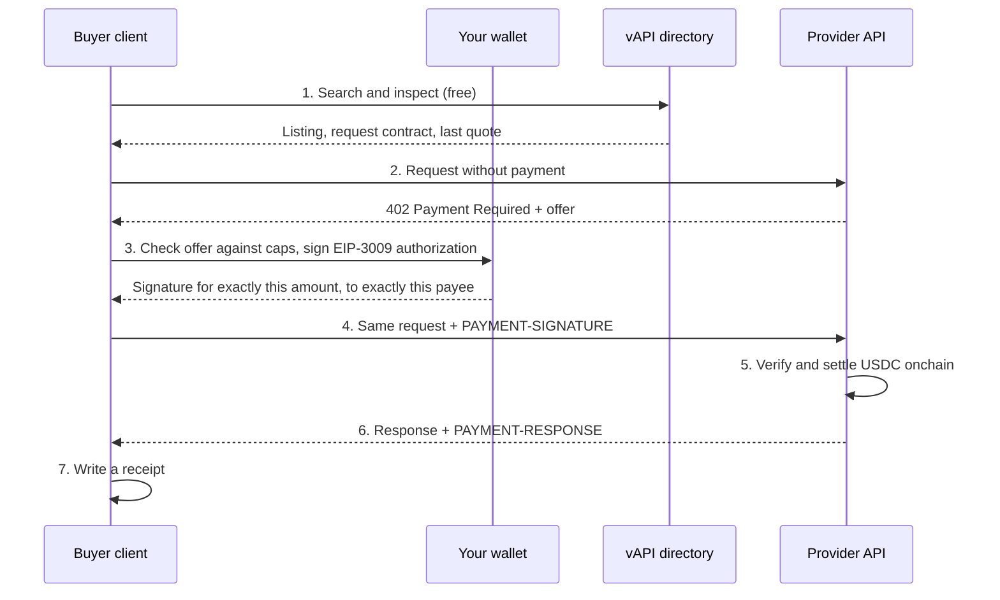

This page follows one paid request from start to finish. Read it when you want to know what you are signing, who receives the money, and where vAPI stands in the flow.

## One paid request

This flow shows Base and Arc payments. The console also supports Solana mainnet, with the signing difference described below.

1. **Find an API.** You search the directory in the console, with `vapi search`, through the MCP tools, or on the public discovery API. Search and inspect are free and need no wallet.
2. **Ask for the price.** Your client sends the request without a payment. The API answers `402 Payment Required`. The offer is in the `PAYMENT-REQUIRED` header, base64-encoded JSON, and sometimes in the body too. It names the scheme (`exact`), the network, the USDC contract, the amount in USDC's smallest unit, the payee, and a settlement window.
3. **Sign.** The client checks the offer against your limits: `--max` or `maxPriceUsd` for this call and the wallet's per-call and per-day caps. If it fits, your wallet signs one EIP-3009 `transferWithAuthorization` message: this amount, this payee, a nonce, and a validity window. Nothing is broadcast and no gas is spent. In the console your browser wallet shows the same typed data for you to sign.
4. **Send again.** The client repeats the request with the signature in the `PAYMENT-SIGNATURE` header.
5. **The provider settles.** The provider, usually through an x402 facilitator, submits the authorization to the USDC contract. USDC moves from your address to the payee named in the offer.
6. **You get the answer.** The response carries a `PAYMENT-RESPONSE` header with the settlement details.
7. **A receipt is written.** The `vapi` client stores the quote, the settlement and the latency locally. The console shows the settlement reference on the page.

Every payment sent by the console or the `vapi` client carries the x402 `builder-code` value `vapi`. That is how the network statistics count volume routed through vAPI. See [x402 extensions](/call/reference/x402-extensions/).

## What you are signing

On Base and Arc, an EIP-3009 authorization is a signed permission for the USDC contract to move an exact amount from your address to one payee, once, within a time window. It cannot be reused, it cannot move more than the amount, and it expires. The offer in the 402 is the only input: if the live offer differs from the price shown in the directory, the live offer wins and your client compares it with your limits before signing.

There is no token approval transaction for these payments. The provider pays the gas to settle.

On Solana, the console asks the buyer's wallet to sign a transaction containing compute-budget instructions, a USDC `TransferChecked` to the payee's associated token account, and a memo. The facilitator is the fee payer.

## Where vAPI stands

| vAPI does                                                     | vAPI never does                                          |
| ------------------------------------------------------------- | -------------------------------------------------------- |
| Runs the directory and the free discovery API                 | Hold your funds or a balance for you                     |
| Probes every listing and rechecks it for liveness             | Sign a payment for you or hold your key                  |
| Shows verification, fee and liveness facts before you pay     | Relay your call to a provider-hosted endpoint            |
| Publishes the open-source client with local caps and receipts | Charge for search or inspection                          |
| Counts network volume from the `builder-code` tag             | Change the price: the provider's live offer is the price |

A listing's payee is whatever the live offer names. vAPI Call takes no fee. New self-listed APIs pay the wallet the provider proved by signature, directly. Legacy listings that still pay a stored `FeeSplitter` retain their disclosed 5% fee until migrated. See [Groups and fees](/call/reference/groups-and-fees/).

Some partners use a vAPI-hosted shim; its x402 challenge pays the partner's own wallet, and vAPI never receives the payment. See [o1 Launchpad](/call/providers/o1/).

## Groups and verification

The directory sorts listings into four groups by where they come from. Verification is a separate tier that an operator grants after testing the API.

| Group              | Source                                                              | Network fee             |
| ------------------ | ------------------------------------------------------------------- | ----------------------- |
| vAPI endpoints     | vAPI's own paid APIs, listed through the same flow as anyone else's | None for direct payout  |
| Added APIs         | APIs their owners listed through the console or `vapi publish`      | None for direct payout  |
| Verified Providers | Partners added by a vAPI operator                                   | None when paid directly |
| External           | Mirrored from the Coinbase x402 Bazaar                              | None                    |

Default search shows verified listings and fresh External listings. Switch on **Include unverified APIs** in the console, `--include-unverified` in the CLI, or `includeUnverified: true` in MCP and the SDK to add self-listed APIs that passed the automated probe but were not reviewed. See [Find APIs](/call/use-call/find-apis/).

## Limits and safety

- **Caps are yours.** The `vapi` client applies the wallet's per-call and per-day caps before it signs. The defaults are $0.10 per call and $1.00 per day. Each call also takes a maximum price. The console shows the amount in your wallet before you sign.
- Exact only. The console pays `exact` USDC offers on Base, Arc mainnet and Solana mainnet. The CLI and local MCP 0.14.0 pay Base and Arc; Solana listings appear in search, but inspect/pay return `unsupported_network`. Listings with `upto` or `auth-capture` offers, or with a Stripe/Tempo MPP challenge, are shown but cannot be paid here. See [Networks and schemes](/call/reference/networks-and-schemes/).
- **Lost responses.** If a paid call returns nothing, do not pay again blindly. `vapi pay --resume <receipt-id>` reads the authorization's state onchain and tells you whether it settled. See [Receipts and retries](/call/use-call/receipts-and-retries/).
- **Liveness and verification are facts, not guarantees.** vAPI rechecks listings and shows what it saw. A successful probe is not an audit of the provider.

Call statistics use retained snapshots. The console describes these as “Onchain x402 payments to the APIs Call indexes.”
The 7d and 30d totals combine closed UTC-day rollups with live today.
Producers use live summaries if rollup coverage is incomplete or outdated; reads do not start expensive summaries.

| Window | Freshness                                                                     |
| ------ | ----------------------------------------------------------------------------- |
| 24h    | Fresh for one minute, stale for another 15 minutes.                           |
| 7d     | Fresh for 15 minutes; snapshots retained another day beyond the stale window. |
| 30d    | Fresh for 15 minutes; snapshots retained another day beyond the stale window. |

Failed refreshes preserve last-good data and its generatedAt timestamp. Missing snapshots fail immediately.
The console shows “Stats unavailable” when statistics cannot be read.

## Next

- [Quickstart: your first paid call](/call/quickstart/)
- [Pay with the CLI, MCP and SDK](/call/use-call/pay-with-vapi/)
- [x402 payments and facilitator flow](/reference/x402/x402/)

Checked on 2026-11-17.
